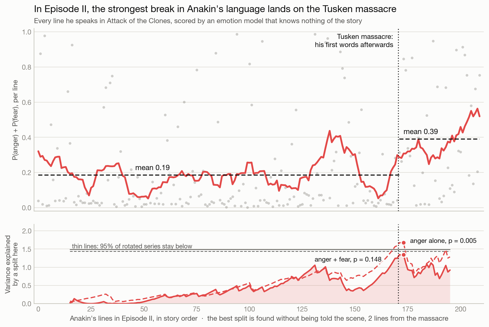
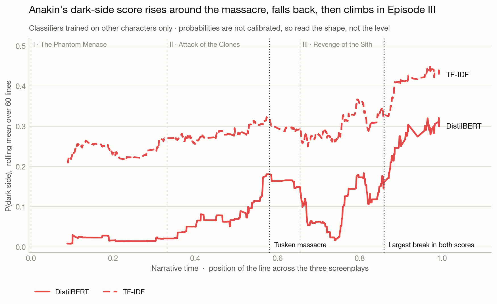
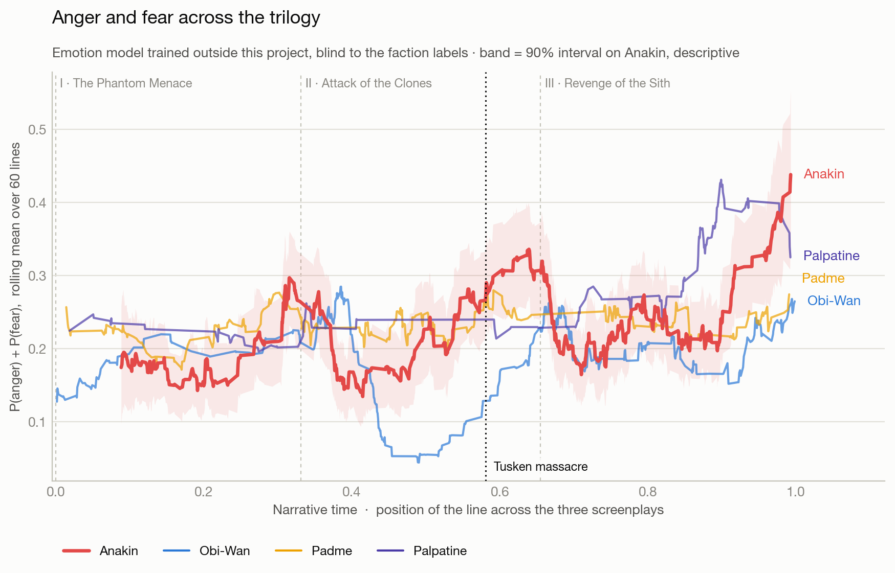
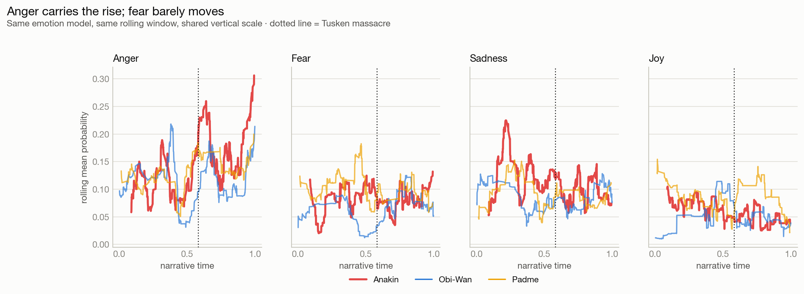
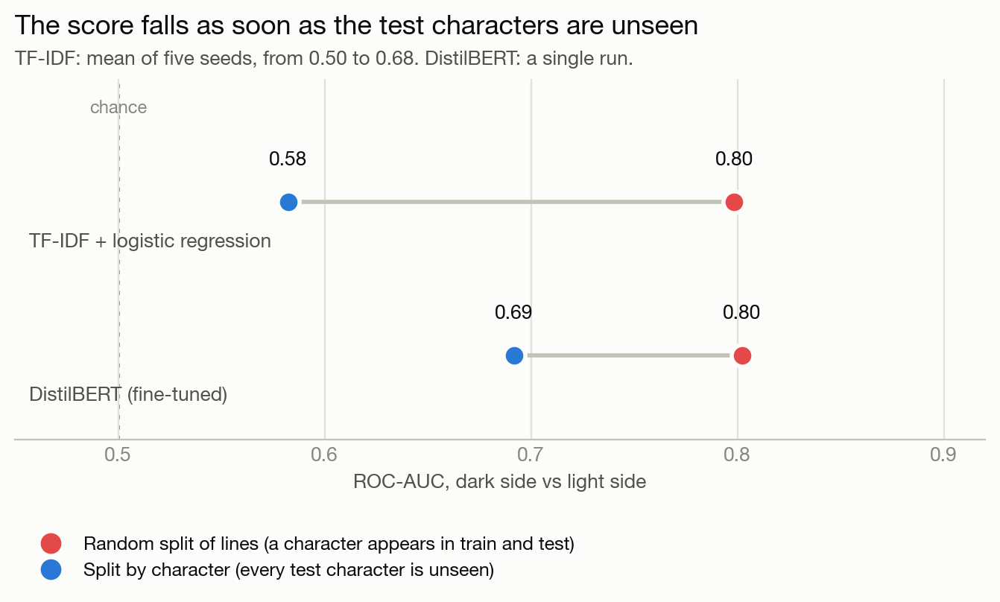

# Did Anakin Skywalker's language actually change?

Measuring a character's turn to the dark side from screenplay dialogue alone. This is
a rebuild of a project from my master's in statistics and artificial intelligence.



## The short answer

Yes, it changes, but not at one single moment.

1. **Inside Episode II, the strongest break lands on the Tusken massacre.** Told nothing
   about the story, a search for the best split in the episode falls within 2 lines of
   his first words after the massacre.
2. **That break does not last.** He returns to his earlier level at the start of
   Episode III.
3. **Across the whole trilogy, the largest breaks come later**, in Episode III: first
   in the dark-side score, just before the Chancellor's office scenes, then in anger
   and fear at Mustafar.
4. **My original result did not hold up.** Most of its apparent skill came from a
   validation split that let characters appear in both training and test.

## The Tusken massacre

Anakin says nothing during the massacre. His first words afterwards are in the
homestead garage (Episode II, scene 125), so that is where it can first show in
dialogue. Each line is scored by an emotion model trained elsewhere, which knows nothing
of Star Wars or of this project's labels. `P(anger) + P(fear)` is the measure chosen
before any line was scored.

| Measure, Episode II only | Before | After | Step, p | Best split found blind | Blind split, p |
|---|---|---|---|---|---|
| P(anger) + P(fear) | 0.185 | 0.391 | 0.010 | 2 lines after | 0.148 |
| P(anger) alone | 0.088 | 0.318 | 0.005 | 2 lines after | 0.005 |
| P(dark side), DistilBERT | 0.059 | 0.269 | 0.034 | 1 line after | 0.080 |
| P(dark side), TF-IDF | 0.279 | 0.339 | 0.045 | 1 line before | 0.386 |

<sub>"Step" tests a rise at the massacre. "Blind" searches every possible split, with at
least 15 lines on each side, and asks whether a split that good appears by chance. Both
use rotation tests, explained under [Method](#method).</sub>

**What supports it.** All four measures rise at the massacre, and all four blind searches
land within 2 lines of it. The rise does not rest on the garage scene alone: without it,
the after-massacre mean of `P(anger) + P(fear)` is still 0.369, and 0.286 once the
angriest later scene (the gunship, scene 164) is removed as well.

**What limits it.**

- The location is a best estimate, not a precise measurement. When the scenes are
  resampled, the break lands on scene 125 in 28% of runs, and the 90% interval runs from
  scene 21 to scene 164.
- Only anger clears the bar in the blind search. `P(anger) + P(fear)`, the measure chosen
  in advance, does not.
- With a minimum of 5 or 10 lines per side, the emotion measures and DistilBERT move to
  later scenes (the gunship, scene 164, and scene 160).
- Padmé rises at the same point too (anger 0.106 to 0.239), possibly because the war is starting.
  Anakin's jump is larger, but the difference is not statistically clear
  (+0.097, 95% CI −0.085 to +0.244). Against Obi-Wan it is clear for anger
  (+0.210, CI +0.021 to +0.340), not for anger + fear (+0.184, CI −0.013 to +0.344).
- I looked at this scene because of the story and the curves. The location comes from
  the screenplay, but limiting the search to Episode II was my choice, so this is an
  informed reading rather than a blind discovery.

These numbers measure what his dialogue expresses. The moral turn itself is an
interpretation.

## Across the whole trilogy



The score comes from classifiers trained to separate the Jedi/Republic camp from the
Sith/Separatist camp, without ever seeing Anakin's lines. It rises through the trilogy
(DistilBERT ρ = +0.33, p = 0.002; TF-IDF ρ = +0.21, p = 0.011).

| | Before massacre | After, Episode II | Episode III, first half | Episode III, second half |
|---|---|---|---|---|
| P(anger) + P(fear) | 0.185 | 0.391 | 0.204 | 0.272 |
| P(dark side), DistilBERT | 0.059 | 0.269 | 0.057 | 0.216 |

Searching the whole trilogy, both classifiers pick the same line at position 0.86, in
Episode III (DistilBERT 0.067 to 0.294, p = 0.003; TF-IDF 0.275 to 0.429, p = 0.002). It
falls in scene 103, just before the Chancellor's office scenes (116 to 130); the script
has him kneel in scene 128. The classifiers may partly be picking up the subject of those
conversations rather than a change in Anakin, since half of the dark-side training lines
are Palpatine's.



Anger and fear also rise overall (ρ = +0.129, p = 0.006). A single break for this measure
is not stable: it lands at Mustafar with a minimum of 15 or 30 lines per side (p = 0.020
and 0.004), and on Naboo with a minimum of 50 (p = 0.073).

This rise is not clearly his alone. Compared with the 19 light-side characters pooled, his
slope is steeper (+0.103), but the interval includes zero (95% CI −0.009 to +0.213), and
the same holds against Obi-Wan, Padmé and Palpatine individually.

## Which emotions move

| Emotion | ρ vs story time | p | p, Holm-adjusted |
|---|---|---|---|
| surprise | −0.234 | 0.008 | 0.051 |
| joy | −0.169 | 0.006 | 0.039 |
| anger | +0.118 | 0.070 | 0.254 |
| disgust | +0.094 | 0.013 | 0.063 |
| fear | +0.085 | 0.063 | 0.254 |
| neutral | +0.063 | 0.497 | 0.994 |
| sadness | −0.034 | 0.585 | 0.994 |



Surprise and joy fall more clearly than anger rises. Read this with care: most of the fall
happens between Episodes I and II, where the script source changes and the character goes
from child to young man. Inside Episodes I and II it is not significant. Question marks
are part of the surprise score (0.40 with one, 0.10 without), but removing those lines does
not remove the fall (ρ = −0.27, p = 0.010).

## What was wrong with the original



**The split.** The label belongs to a character, not to a sentence. With a random split of
lines, Yoda sits in both training and test, so a model can score by learning how Yoda talks.
Anakin, though, is never in training. Holding each character out whole takes TF-IDF from
ROC-AUC 0.80 to 0.58 on average.

**The cumulative curve.** The headline figure counted "evil" lines cumulatively. A running
count can only rise, so a rising curve showed nothing about a fall.

**DistilBERT shows no demonstrated gain.** The 0.69 and 0.58 above should not be compared
directly: DistilBERT ran once, and TF-IDF's score moves from 0.50 to 0.68 with the seed. On
identical folds they score 0.69 and 0.68. Without Palpatine, TF-IDF scores higher (0.68
against 0.60).

| | Original | Rebuild |
|---|---|---|
| **Validation** | Random split of lines | `StratifiedGroupKFold` by character, with the random split kept for comparison |
| **Headline plot** | Cumulative count of "evil" lines | Rolling levels and before/after steps |
| **Name cleaning** | `SequenceMatcher` at 0.8 on every uppercase token. It fixed real typos (`ANKAIN`) but also turned `MACE` into `MENACE` | Explicit alias table, read off the real cue frequencies |
| **Text cleaning** | Punctuation removed before analysis | Punctuation and casing kept |
| **Labels** | Two ChatGPT-generated lists, with names cut short by the regex (`TEY HOW` became `HOW`) and most antagonists counted as dark side | Curated camps; 12 characters left unlabelled, each with a recorded reason |
| **Same person** | `AMIDALA` and `PADME` kept apart | Personas merged (Padmé/Amidala, Palpatine/Sidious, Anakin/Vader) |
| **Sentiment** | TextBlob polarity on stripped text | 7-way emotion model on clean text |
| **Evidence** | Reading the shape of a curve | Rotation tests and scene-level intervals |

## Method

- **Data:** 2,940 lines from 64 characters, parsed from three differently formatted
  screenplays. 1,842 labelled lines from 26 characters train the classifiers.
- **Emotions:** [`j-hartmann/emotion-english-distilroberta-base`](https://huggingface.co/j-hartmann/emotion-english-distilroberta-base).
- **Classifiers:** TF-IDF with logistic regression, and a fine-tuned DistilBERT. Anakin's
  lines are scored by a model fitted on all labelled characters; he is never in training.
- **p-values:** rotation tests. The series is circularly shifted against story time, for
  every possible shift. Neighbouring lines are correlated, and shuffling them one by one
  would give p-values that are too small. The smallest reachable value is 1/n.
- **Confidence intervals:** scenes are resampled rather than lines, for the same reason.

## Limitations

- **Seven dark-side characters, and Palpatine has 52% of their lines.** That class is
  largely one voice, and this is the main constraint on the classifiers.
- **Many tests on one small dataset.** Only the emotion table is adjusted for multiple
  comparisons, so isolated p-values near 0.05 are weak evidence.
- **The three scripts differ in source and stage.** Episode II is a revised draft, not a
  transcript. Changes between episodes can come from this, which makes comparisons within
  an episode more reliable.
- **Story time is line rank, not screen time.** Scripts carry no timestamps.
- **The models are out of domain and uncalibrated here,** so trends and contrasts mean more
  than absolute levels. Anakin's dark-side score and the controls' also come from models
  fitted on different training sets.

## Running it

Requires Python 3.12. On Apple Silicon the transformer steps use MPS automatically.

```bash
pip install -r requirements.txt
python scripts/00_fetch_scripts.py   # downloads the screenplays into data/raw/
make all                             # dataset, models, emotions, figures, notebook
```

```bash
make dataset      # parse three screenplay formats into one table
make models-fast  # TF-IDF only, keeps existing DistilBERT results
make models       # adds DistilBERT, about 20 minutes on an M-series Mac
make emotions     # score every line with the emotion model
make arc          # statistics and figures
make notebook     # rebuild and execute the notebook
make report       # rebuild the PDF, needs XeLaTeX
```

- [`docs/project_report.pdf`](docs/project_report.pdf): the full write-up
- [`notebooks/anakin_fall.ipynb`](notebooks/anakin_fall.ipynb): the results, loaded from the computed files
- [`reports/`](reports/): every number above, as JSON and CSV
- [`legacy/`](legacy/): the original master's notebooks

```
src/anakin_nlp/
  scrape.py       fetch the three screenplays
  parse.py        one parser for three screenplay layouts
  characters.py   alias table, camps, documented exclusions
  events.py       story events, located from the screenplay
  models.py       TF-IDF baseline and the grouped validation protocol
  transformer.py  DistilBERT under the same protocol
  emotions.py     7-way emotion scoring
  arc.py          trends, breaks, rotation tests, scene-level intervals
  viz.py          figures
  palette.py      chart palette and colour checks
```

## Data and licence

The screenplays are third-party copyrighted works. This repository ships the code that
fetches them, not the texts: `data/` is git-ignored, and no figure, output or notebook cell
reproduces dialogue. The code is under the [MIT licence](LICENSE), which does not cover the
screenplays.
